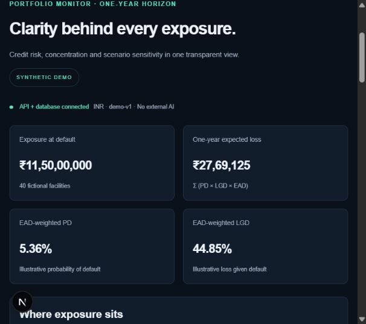

# AegisRisk

Banking risk intelligence and explainable credit analytics. Educational portfolio project; synthetic data only. Not a credit approval system and not affiliated with a bank or regulator.

**Mathematics calculates. Models estimate. AI explains. Humans decide.**

Implementation is in progress. See [milestones](docs/MILESTONES.md) for verified status. External AI is disabled by decision; no API key is needed. The foundation source is published on [GitHub](https://github.com/animeshpthk07/AegisRisk) under the MIT license. A public hosted application is not yet verified.

## Current foundation scope

- Next.js / React / TypeScript dashboard with accessible tables, Recharts, dark/light themes and error states.
- FastAPI versioned API, SQLAlchemy facilities, Alembic migrations and explicit fictional seed.
- Facility/portfolio expected loss, EAD-weighted metrics, borrower HHI, industry exposures and bounded scenario sensitivity.
- Deterministic narrative derived from backend totals, not an LLM.
- PostgreSQL Docker Compose configuration, local SQLite verification fallback, tests and CI definition.
- Bounded synthetic CSV and values-only XLSX preview: file validation, row-level issues and independently calculated totals, without saving or replacing the active portfolio.
- Opt-in reviewed CSV / XLSX snapshots: immutable saved portfolios, duplicate-file reuse, dataset selection and dataset-scoped calculations. Saving is disabled by default.
- Downloadable baseline JSON and printable HTML reports with decimal calculation evidence, deterministic explanations, dataset identity and a canonical source fingerprint.
- Scenario-comparison JSON and printable HTML reports bound to the calculated assumptions, with baseline/stressed totals, scope, cap flags and facility-level decimal evidence.

**Not yet the complete product:** no trained ML model, server-generated PDF reports, authentication or verified public deployment. No real-world banking validation or regulatory compliance claims.

Read [development guide](docs/DEVELOPMENT.md), [architecture](docs/ARCHITECTURE.md), [security notes](docs/SECURITY.md), and [API contract](docs/CONTRACT.md). Verification results are recorded in the milestone tracker, not inferred from the existence of source files.

## Latest verified checkpoint — 21 October 2026

[Verification run #23](https://github.com/animeshpthk07/AegisRisk/actions/runs/39491329995) passed all four jobs for commit `c8d6f66`: backend, frontend, full-stack Chromium and PostgreSQL container lifecycle. The preceding [container checkpoint](https://github.com/animeshpthk07/AegisRisk/actions/runs/39445548042) recorded 48 passing browser cases against the real Compose images, safe default saving behavior and unchanged evidence after database/application restart and repeat migrations/seed.

These checks cover a synthetic educational workflow, not production banking validation. CI evidence artifacts expire after seven days; source, test definitions and run summaries remain inspectable. See the [reviewer walkthrough](docs/DEMO_GUIDE.md) for a reproducible demonstration, expected calculations, failure checks and honest interview talking points.

The historical checkpoints below describe when individual features were introduced; they are not separate claims that the full product is complete.

## Historical foundation checkpoint

[GitHub verification run #1](https://github.com/animeshpthk07/AegisRisk/actions/runs/38502931162) passed on 14 October 2026: backend tests/lint, PostgreSQL migration/read smoke, frontend typecheck/tests/build, and dependency-audit steps. See the milestone tracker for scope and limitations.

## Local demo preview

This image is from the earlier locally verified foundation demo, not a hosted production release.

## Synthetic CSV preview checkpoint

[GitHub verification run #5](https://github.com/animeshpthk07/AegisRisk/actions/runs/38730979855) passed on 15 October 2026 for commit `f0c0caf`: backend and frontend checks completed successfully.

In the dashboard, open **CSV / Excel preview**, choose **Use fictional example**, confirm synthetic-only data, then select **Validate and preview**. The two-row example should report INR 3,000 EAD and INR 66 one-year expected loss. A download link provides the example CSV. Invalid files show record/field errors and no partial totals.

The preview supports UTF-8 CSV up to 256 KiB / 1,000 rows. It is independent of the database portfolio, uses no external AI, and never saves uploaded data. See the [validation contract](docs/CONTRACT.md). [Full-stack verification run #8](https://github.com/animeshpthk07/AegisRisk/actions/runs/38855476887) passed on 16 October 2026 for commit `5e8ce09`: backend, frontend and Chromium browser jobs succeeded. The browser checks exercise the production Next.js app, real API and isolated fictional database, including desktop/mobile examples, uploads, rejection paths and retry recovery. Synthetic-only screenshots, traces and results are retained as a seven-day CI artifact. See the [reproduction guide](docs/DEVELOPMENT.md#full-stack-browser-verification).

That historical run verifies the CSV-preview slice only, not the later snapshot feature, full accessibility, other browser engines, production security or a public deployment.

## Reviewed saved portfolios

[Verification run #12](https://github.com/animeshpthk07/AegisRisk/actions/runs/38982082684) passed on 17 October 2026 (Asia/Kolkata) for commit `73cc16b`: backend, frontend and full-stack Chromium checks succeeded, including reviewed saving, duplicate reuse, reload, selection and stale stress-response protection. Historical failures remain in the Actions history.

On a local, single-user instance, explicitly set `SYNTHETIC_IMPORTS_ENABLED=true` on the API process after applying migrations. Keep it disabled on shared or public instances: this feature has no authentication, tenant isolation, retention policy or total storage quota.

1. Validate a fictional CSV or values-only XLSX and inspect its totals.
2. Enter a name, confirm that you reviewed the totals, then choose **Save reviewed portfolio**.
3. Choose **Open saved portfolio**. The portfolio, facilities, explanation and stress calculations use that snapshot together.
4. Use **Active portfolio** to return to the built-in demo or another saved file. Reload returns the selection to the demo, but saved files remain available in the catalog.

Previewing does not save. Saving does not switch datasets or overwrite the demo. Matching stored bytes reuse the original snapshot and name: original bytes for CSV, normalized CSV values for XLSX. The server revalidates every save and checks the preview digest; errors never silently fall back to the demo. Only synthetic data is supported.

## Baseline evidence download

Choose the active portfolio, then **Download baseline report (JSON)**. The download contains the baseline summary, facility inputs, decimal-computed EL evidence, industry breakdown, source fingerprint and methodology/disclaimers. It intentionally excludes the current stress scenario. The JSON format is inspectable and machine-readable; server-generated PDF reports remain future work.

This report is not an audit opinion, regulatory calculation or credit recommendation. Its fingerprint identifies canonical input content, not authenticity. Dataset switches cancel pending exports. See the [report contract](docs/CONTRACT.md#baseline-evidence-report-json) for schema, rounding and error behavior, and the milestone tracker for verification evidence.

## Scenario comparison download

In **Stress laboratory**, choose the PD/LGD/EAD multipliers and industry scope, then **Calculate scenario →**. The result prints the assumptions used. Choose **Download scenario report (JSON)** to export that comparison with its baseline source evidence.

Editing any assumption or switching portfolios clears the previous result and cancels pending scenario calculations/downloads. Recalculate before exporting. The browser rejects reports whose dataset, assumptions or result totals do not match the calculation. Failed exports can be retried; they never substitute an older report.

These are synthetic sensitivity assumptions, not economic forecasts or trained estimates. Scenarios are not persisted. PDF presentation and production deployment remain separate milestones. See the [scenario report contract](docs/CONTRACT.md#scenario-comparison-report-json) and the milestone tracker for verification status.

## Values-only Excel imports

Choose a fictional `.xlsx` file in the same preview panel. Use exactly one visible worksheet, the documented ten-column header in row 1, and at most 1,000 data rows. PD/LGD are fractions, EAD is INR, and the horizon is one year. Copy values into a clean workbook: formulas, dates, hidden content, merged cells, filters, links and macros are deliberately rejected. XLS and XLSM are unsupported.

Uploads are limited to 256 KiB with additional ZIP expansion and XML safety checks. Preview is read-only. Saving remains an explicit local-only opt-in; it stores normalized CSV values, not the workbook or formatting. Every save rechecks both the uploaded-byte review fingerprint and the stored-value fingerprint. See the [contract](docs/CONTRACT.md#values-only-xlsx-safety-and-storage) for precise limits and deduplication behavior.

Excel-specific API and desktop/mobile browser tests are included. Their verification status is tracked in [milestones](docs/MILESTONES.md); implementation alone is not evidence that the checks passed.

## Readable reports for review and printing

Choose **Download baseline report (printable HTML)** for the active portfolio, or calculate a scenario and choose **Download scenario report (printable HTML)**. Open the downloaded HTML file in your browser. Use the browser’s Print command to print or save as PDF; this is not a server-generated PDF export.

The document is self-contained with no scripts, external assets or network dependencies. It includes dataset identity/time, exact supplied decimal evidence, assumptions, methodology, source fingerprint and limitations. Weighted ratios/HHI are rounded for presentation. Text from the portfolio is HTML-escaped. The JSON download remains available for machine-readable evidence.

These exports use the same identity and stale-response checks as JSON. They do not train a model, sign the evidence, save scenarios or confer banking/regulatory validation. Browser/print-layout verification is recorded in [milestones](docs/MILESTONES.md).
