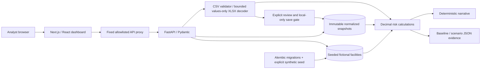

# AegisRisk architecture

PostgreSQL is the deployment target. SQLite is an explicit local/test fallback, not a parity claim. CI checks PostgreSQL migration/read smoke and Chromium against a production Next.js build, real API and isolated fictional database. Docker Compose configuration is present; full hosted/Compose deployment is not yet verified.

## Decisions and boundaries

- Separate frontend/backend, versioned API, fixed proxy paths. No user-controlled upstream URL; bounded request streams and timeouts.
- Preview is read-only. CSV/XLSX share validation and calculations. XLSX archives/XML are checked before openpyxl, then only normalized values are retained if explicitly saved.
- Save is disabled by default. Enabling it is only for a local single-user synthetic demo; no accounts, tenant isolation, global storage quota or retention/deletion controls yet. Never upload customer information.
- Save revalidates raw bytes against the reviewed fingerprint. Stored content has its own integrity digest and immutable UUID. Equal stored bytes reuse a snapshot. Neither digest is an authenticity signature.
- Dataset selection is explicit. Invalid, unknown, disabled or corrupt saved data fails closed instead of falling back to the demo. Reload resets selection, not saved data.
- Seed/migrations are explicit; the seed never overwrites a nonempty portfolio. Scenario and report requests do not persist changes.
- Decimal expected-loss calculations supply all totals and deterministic explanations. JSON/chart numbers are presentation values; reports also carry decimal-string evidence and stated precision.
- Assumption edits/dataset switches invalidate pending calculations and downloads. Export checks bind scenario evidence to the visible calculation and selected dataset.
- PD/LGD are assigned illustrative inputs, not predictions. No trained model, external AI, API key or invented model metrics. One currency (INR), one-year horizon.
- pnpm lockfile pins frontend resolution. XLSX parser packages are exactly pinned; remaining Python dependencies are bounded and audited in CI, not yet fully locked.
- Next.js follows the requested stack. No Sites registration or publication.

## Remaining product work

Trained model/calibration and measured evaluation, formatted/PDF reporting, authentication and production security, verified hosting and final learning/demo materials remain unfinished. Read [milestones](MILESTONES.md) for exact verified commits: source presence is not test evidence.

The risk engine loads bounded fictional datasets in memory. Larger real portfolios would require database-side aggregation, pagination, tenancy, access controls and independent domain validation. Readiness checks schema presence, not an expected facility count; an empty portfolio is valid and disclosed.
