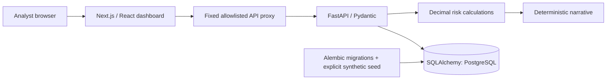

# Foundation architecture

Local verification can use SQLite where PostgreSQL is unavailable; this is not a claim of PostgreSQL parity. Docker Compose describes the production-target database topology. The API has separate liveness and database/schema readiness endpoints.

## Decisions

- Separate frontend/backend, versioned API, fixed proxy allowlist. No user-controlled upstream URL.
- No accounts, private financial data, external AI, credentials, uploads or public mutations in this foundation. Scenario POST is stateless and does not persist changes.
- Synthetic seed is explicit and will not replace a nonempty portfolio. Database migrations are explicit, not triggered by an HTTP request.
- Decimal arithmetic for expected loss. JSON/chart values are display floats; these are not accounting-ledger exports.
- PD/LGD are assigned illustrative inputs. No trained predictive model exists yet.
- One currency (INR), one-year horizon, one demo snapshot. No fabricated trends.
- pnpm lockfile pins frontend dependency resolution. Python dependencies initially bounded; exact lock pending installation verification.
- Next.js rather than the Sites hosting starter follows the user's explicit stack. Work remains local only; no Sites registration or publication.

## Known foundation limitations

No CSV/XLSX import, model training, calibration, user-defined dataset versions, PDF reports, authorization, public hosting or full E2E suite yet. Portfolio API loads the small demo in memory; replace this with database-side aggregation/pagination before large imports. Readiness checks schema presence but not expected row count; an empty portfolio is valid and disclosed separately.
